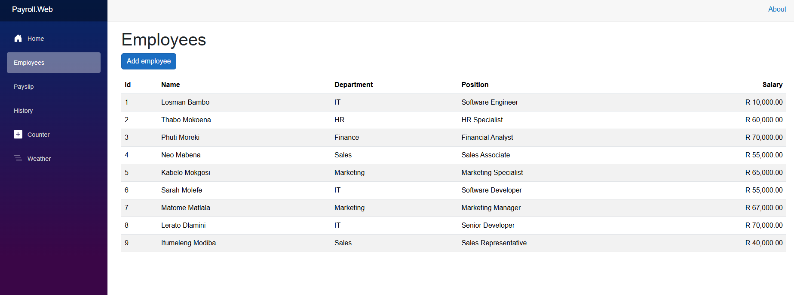
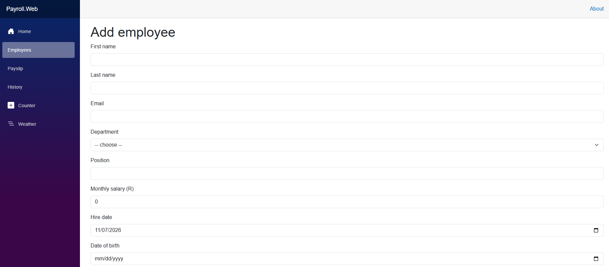
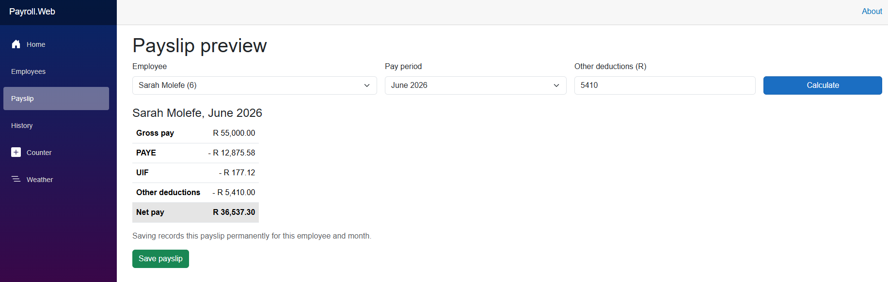
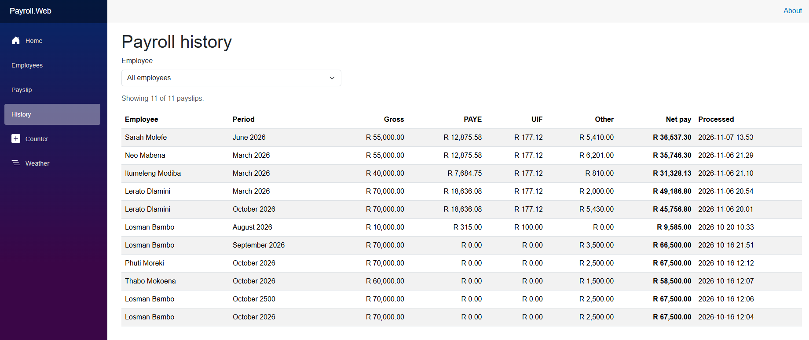

# C# Employee Payroll System

An employee management and payroll system built in C# on .NET 10, using Microsoft SQL Server through ADO.NET. It started as a console application and now also has an ASP.NET Core Web API and a Blazor WebAssembly front end, all sharing the same payroll logic. The focus is defensive programming, data integrity, automated testing and South African tax compliance (2026/27 tax year).

## Screenshots

| Employees | Add employee |
|---|---|
|  |  |

| Payslip preview and save | Payroll history |
|---|---|
|  |  |

## Solution structure

| Project | Type | Purpose |
|---|---|---|
| `Payroll.Core` | Class library | Shared models (`Employee`, `PayrollRecord`, `Departments`), the `PayrollCalculator`, the repository interfaces (`IEmployeeRepository`, `IPayrollRepository`) and the SQL Server implementation (`DatabaseHelper`) |
| `Payroll.ConsoleApp` | Console app | The original menu-driven application |
| `Payroll.Api` | ASP.NET Core Web API | REST endpoints for employees, departments and payroll |
| `Payroll.Web` | Blazor WebAssembly | Browser front end that calls the API |
| `Payroll.Tests` | xUnit test project | Unit tests for the tax calculations and the API controllers |

Payroll rules live in one place (`Payroll.Core`), so the console app, the API and the web app always calculate the same way. The browser contains no tax logic: it sends choices and displays what the API returns.

## Features

- **Employee management:** add, view, update and delete employees from the console app, the REST API or the web app. Employee Ids are generated by the database.
- **Payroll calculation:** PAYE (2026/27 brackets with age-based rebates), UIF (with the statutory cap) and net pay.
- **Payslip preview:** calculate a payslip for any employee and pay period without saving anything.
- **Payslip saving:** save a payslip once per employee per month. A second attempt for the same month is refused.
- **Payroll history:** list saved payslips, newest first, with an employee filter in the web app.
- **Data integrity:** a unique constraint prevents duplicate payroll for the same employee and period, and a foreign key stops an employee with payroll records from being deleted.
- **Validation and error handling:** input validation on the API, meaningful HTTP status codes, and a generic error response for unexpected failures.

## API endpoints

| Method | Route | Purpose | Status codes |
|---|---|---|---|
| GET | `/api/employees` | List all employees | 200 |
| GET | `/api/employees/{id}` | Get one employee | 200, 404 |
| POST | `/api/employees` | Create an employee (Id generated by the database) | 201, 400 |
| PUT | `/api/employees/{id}` | Update an employee | 204, 400, 404 |
| DELETE | `/api/employees/{id}` | Delete an employee | 204, 404, 409 (has payroll records) |
| GET | `/api/departments` | List department names | 200 |
| GET | `/api/payroll/{employeeId}?month=&year=&otherDeductions=` | Preview a payslip (nothing is saved) | 200, 400, 404 |
| POST | `/api/payroll` | Calculate and save a payslip | 201, 400, 404, 409 (already processed) |
| GET | `/api/payroll/records` | List saved payslips, newest first | 200 |

Department is sent and received as its name rather than a number. Interactive documentation and a test console are available at `/scalar/v1` while the API is running in Development.

## Tax rules and limitations

- **Tax year:** the tables are for the 2026/27 South African tax year (1 March 2026 to 28 February 2027). Payroll can only be processed for pay periods in that range; anything outside it is rejected.
- **PAYE:** annual tax from the 2026/27 brackets, minus the primary, secondary (65+) or tertiary (75+) rebate based on the employee's age at the end of the tax year, divided by 12. A date of birth is required.
- **UIF:** 1% of salary, capped at the R17,712 monthly earnings ceiling (a maximum of R177.12 a month), rounded half-up to the cent. The employer's matching contribution is not modelled.
- **Simplified model:** medical aid credits, retirement fund deductions, bonuses and overtime are not handled.

## Design decisions

- **The server calculates all money.** `POST /api/payroll` accepts only the employee, month, year and other deductions. Clients never send PAYE or net pay, so they cannot save a payslip with figures the system did not calculate.
- **Duplicates are blocked twice.** The API checks first for a friendly 409, and the database's unique constraint is the guarantee if two requests arrive at the same moment.
- **Data access sits behind interfaces.** Controllers depend on `IEmployeeRepository` and `IPayrollRepository`, so they can be tested with in-memory fakes and the database layer can be swapped without touching them.
- **Ids come from the database.** `Employees.Id` is an `IDENTITY` column, so a caller cannot choose or collide with an existing Id.
- **All SQL is parameterized,** and money columns use explicit `DECIMAL(12,2)` parameters.

## Testing

Run all tests with:

```
dotnet test
```

The suite covers:

- **PAYE:** every bracket boundary, the three rebate ages (including a birthday that falls on the last day of the tax year), the zero-tax threshold, and monthly amounts worked out by hand from the SARS tables.
- **UIF:** the cap, the exact ceiling and half-up rounding.
- **Payslip rules:** validation of the pay period, deductions and salary, and complete payslips from gross to net.
- **API controllers:** status codes for every endpoint, using in-memory fake repositories so no database is needed.

Not yet covered: the validation attributes (they run inside the ASP.NET pipeline, so they need integration tests) and the SQL data layer itself.

## Tech stack

- **Language:** C# on .NET 10
- **API:** ASP.NET Core Web API (controllers), OpenAPI with Scalar for documentation and testing
- **Front end:** Blazor WebAssembly
- **Database:** Microsoft SQL Server, ADO.NET (`SqlConnection`, `SqlCommand`, `SqlDataReader`)
- **Testing:** xUnit
- **Environment:** Visual Studio Code and the .NET CLI

## Getting started

Prerequisites: the .NET 10 SDK and SQL Server (Express is fine).

### 1. Create the database

Create a database named `EmployeeManagementDB`, then run `database/schema.sql` against it to create the tables and constraints.

If you created your database with an earlier version of this project (before employee Ids were generated by the database), run `database/migrations/001-employees-identity.sql` instead. It rebuilds the `Employees` table with an `IDENTITY` Id and keeps your existing rows and payroll records.

### 2. Console app

In `Payroll.ConsoleApp/Program.cs`, set the `Server=` part of the connection string to your own SQL Server instance, then run:

```
dotnet run --project Payroll.ConsoleApp
```

### 3. API

Create `Payroll.Api/appsettings.Development.json` (it is git-ignored, so your machine name stays off GitHub):

```json
{
  "ConnectionStrings": {
    "PayrollDb": "Server=YOUR_SERVER_NAME\\SQLEXPRESS;Database=EmployeeManagementDB;Integrated Security=True;TrustServerCertificate=True;"
  },
  "Cors": {
    "AllowedOrigins": [ "http://localhost:5152" ]
  }
}
```

`AllowedOrigins` must contain the exact address the web app runs on (see step 4). Then run the API with the https profile:

```
dotnet run --project Payroll.Api --launch-profile https
```

The terminal prints the address it is listening on. Open that address with `/scalar/v1` added to try the endpoints. If your browser does not trust the development certificate, run `dotnet dev-certs https --trust` once.

### 4. Web app

Open `Payroll.Web/wwwroot/appsettings.json` and set `ApiBaseUrl` to the API's https address, keeping the trailing slash:

```json
{
  "ApiBaseUrl": "https://localhost:7003/"
}
```

Then run the web app in a second terminal:

```
dotnet run --project Payroll.Web
```

Open the address it prints. If the pages show a "could not reach the API" message, check that the API is running and that its `AllowedOrigins` matches the web app's address exactly.

## Known limitations and next steps

- There is no authentication, so the API should not be exposed publicly.
- Medical aid tax credits, retirement fund deductions and other tax-relevant items are not modelled.
- Employees cannot be marked inactive; deleting is blocked once payroll exists. A soft delete would keep history intact.
- Integration tests are needed for the validation rules and the SQL data layer.
- A saved payslip's `Location` header points at the records list. A fetch-one-record endpoint would be more precise.
- The calculator holds the 2026/27 tables in code. Moving them to a table keyed by tax year would make next year's update a data change.